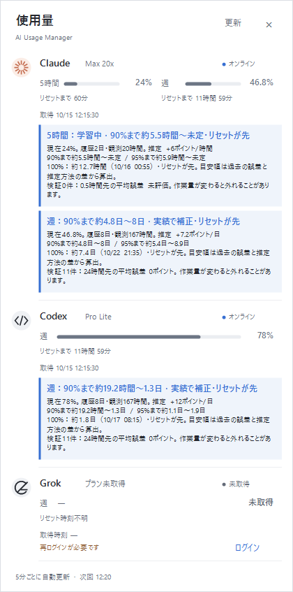
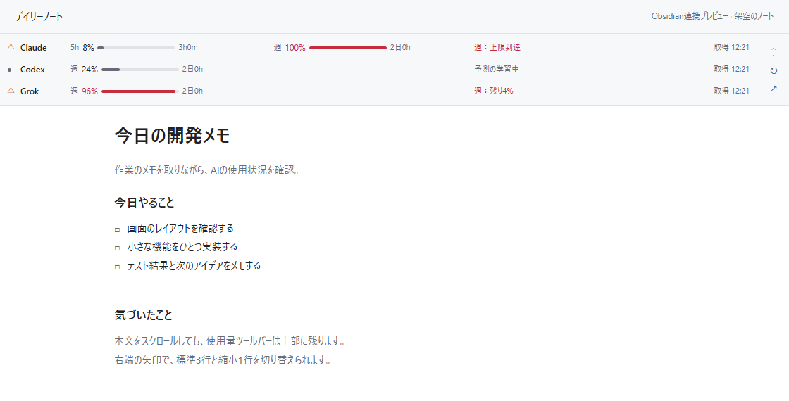
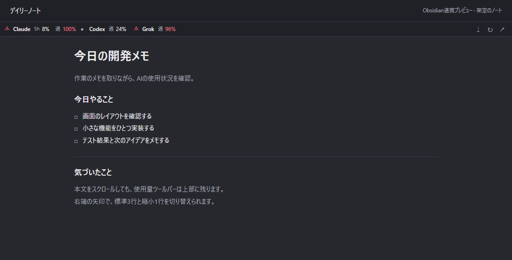

# AI Usage Manager

**Claude・Codex・Grokの使用量とリセット時間を、ひとつの場所で。**

Windows 11のタスクトレイから開く、軽量な使用量モニターです。作業中に残りの枠を確認し、上限が近づいたら通知で気づけます。Obsidianのノート上部やWindowsウィジェットにも表示できます。表示言語は日本語です。

[](https://github.com/genkis3zu/AIUsageManager/actions/workflows/build.yml)

[ダウンロード](https://github.com/genkis3zu/AIUsageManager/releases/latest) · [スクリーンショット](#スクリーンショット) · [はじめる](#はじめる) · [プライバシー](docs/privacy.md) · [MIT License](LICENSE)

| ライト | ダーク |
|---|---|
|  |  |

画像の使用量・プランはすべて架空のサンプルです。本文は`main`の1.1開発版を紹介しています。**公開Releaseのv1.0.0に含まれる機能は、下の[対応版の表](#はじめる)で確認してください。**

## できること

- **3サービスを一覧で確認** — Claudeの5時間・週、CodexとGrokの週枠を表示。プラン名、使用率、リセットまでの時間、取得時刻が分かります。
- **上限が近づいたら通知** — 90%・95%・100%への到達、急増、学習した予測による警告をWindows通知と画面内の文章で知らせます。
- **使い方の傾向から予測** — 使用率の履歴を蓄積し、過去の予測誤差で補正。90%・95%までの目安を幅で表示します。
- **いつもの作業場所に表示** — Obsidianの固定ツールバーは標準3行／縮小1行。Windowsのウィジェットボードにも追加できます。
- **Windows標準の仕組みで常駐** — トレイ版は.NET Framework 4.8 / 4.8.1とWindows Formsで動作。追加ランタイム、WebView2、Node.js、Pythonのインストールは不要です。

5分ごとに自動更新し、手動更新にも対応します。ライト／ダーク／Windowsに合わせる、の3つから配色を選べます。

## スクリーンショット

### 色だけでなく、文章で知らせる

上限到達や急増を警告帯に表示します。予測の詳細には現在の割合、推定ペース、到達までの目安幅、検証件数と平均誤差を表示します。

| 上限・急増の警告 | 履歴から補正する到達予測 |
|---|---|
|  |  |

最初は「学習中」です。週枠は有効な24時間分、5時間枠は30分分と3件以上の観測から参考値を表示します。検証が足りない間は予測による通知を控えます。使い方が変わると外れるため、予測は目安として使ってください。[警告・予測の詳しい仕組み →](docs/alerts.md)

### Obsidianで、ノートを書きながら確認

デイリーノートなどの上部に固定表示します。**本文をスクロールしてもツールバーは残り、ノート本文やテンプレートは変更しません。**

**標準表示：3サービスを3行で。**



**縮小表示：1行でコンパクトに。**



上の2枚は実際のツールバーコードを架空のノート領域に配置したプレビューです。Obsidianのテーマによって周囲の見た目は異なります。使用量と警告は常駐アプリと共有し、プラグインは認証情報にアクセスしません。[Obsidian連携の導入・操作 →](docs/obsidian-guide.md)

### Windowsウィジェットにも

Win+Wのボードへ中／大サイズのカードを追加できます。使用率の確認、手動更新、トレイアプリを開く操作に対応します。

| 中サイズ・ライト | 大サイズ・ダーク |
|---|---|
|  |  |

画像はAdaptive Cardsの公式ホスト設定による架空データのプレビューです。Windowsのボードでの描画には差が出る場合があります。ウィジェットは追加のランタイム・登録が必要なオプションです。[Windowsウィジェットの追加手順 →](docs/widgets-guide.md)

## はじめる

| 使う版 | 含まれる機能 | 入手方法 |
|---|---|---|
| **公開Release v1.0.0** | 基本のトレイ一覧、テーマ切替、5分ごとの更新 | [ReleaseからZIPをダウンロード](https://github.com/genkis3zu/AIUsageManager/releases/latest) |
| **main・1.1開発版** | 上記に加え、ログインボタン、通知、学習する予測、Obsidian連携、Windowsウィジェット | [ソースからビルド](#ソースからビルド) |

**このREADMEの通知・予測・Obsidian・ウィジェット機能は、v1.0.0のZIPには含まれません。**

### トレイ版を起動する

1. Releaseの`AIUsageManager-1.0.0-windows.zip`を、書き込み可能な任意のフォルダーに展開します。
2. **AIUsageManager.exe**を起動します。`AIUsageManager.exe.config`は同じフォルダーに置いてください。
3. タスクトレイの棒グラフアイコンをクリックします。見当たらなければ`^`内を確認してください。

Windows 11と対応CLIの既存ログインや利用記録が必要です。利用できる値がなければ「未取得」になります。トレイ版は管理者権限不要です。インストーラーと自動起動登録はありません。配布ファイルは未署名のため、公式ReleaseとSHA-256を確認してください。保護機能の無効化は必要ありません。

### ログインと操作

1.1開発版では、Codex・Grokの認証が必要になると「ログイン」ボタンが表示されます。インストール済みの公式CLIで認証を開始し、完了後に使用量を再取得します。APIキーのコピーは不要です。ClaudeはClaude Codeの通常のログインを使用します。

| 操作 | 動作 |
|---|---|
| トレイを左クリック | 一覧を開く／閉じる |
| 「更新」またはF5 | 使用量を再取得 |
| 外側をクリック、Esc、× | 一覧を閉じて常駐を継続 |
| 右クリック → テーマ | Windowsに合わせる／ライト／ダーク |
| 右クリック → 通知 | すべて／90%・95%・100%のみ／通知しない |
| 右クリック → 予測の学習 | 学習状態の確認・履歴の削除 |
| 右クリック → 終了 | アプリを終了 |

## 取得するデータ

| サービス | 使用枠 | 主な取得元 |
|---|---|---|
| Claude | 5時間・週 | 既存Claude Codeログインによるオンライン取得。失敗時は既存キャッシュ |
| Codex | 週 | 既存ChatGPTログインによるオンライン取得。通信失敗時はCodexのセッション記録 |
| Grok | 週 | 既存Grok CLIログインによる請求情報。認証・通信失敗時は未取得 |

**未取得と0%を区別します。** 保存値には元の取得時刻を表示し、古い値を新しい値として扱いません。Grokの取得失敗時は古いCLIの使用率へ戻さず、数値とバーを隠します。Ultra・Superなどの新プラン名にも対応します。

GrokはGrok Build CLIの請求情報を参照し、Grok Botの別枠は取得しません。契約名から数値を換算したり、別枠を足し合わせたりもしません。取得先が旧プラン名を返すことがあり、`*`の説明をマウスで確認できます。[取得仕様と制限 →](docs/data-sources.md)

## プライバシーと制限

- 各サービスのログ・認証・設定ファイルは**読み取り専用**です。ログインボタンで起動する公式CLIは、通常の認証と同じように自身の認証情報を保存・更新します。
- 予測用の割合、取得／リセット時刻、サービス枠と既知のプラン名を**このPC内に暗号化して最大90日保存**します。会話内容、トークン、アカウントID、生の応答は保存しません。履歴は削除できます。
- テレメトリーや独自サーバーへの送信はありません。使用量を取得するときだけ、各サービスの固定エンドポイントへ認証情報を送ります。
- 各社の公式アプリではありません。非公開の取得先が変更されると取得できなくなる場合があります。カスタムCLIホーム、複数アカウント切替は未対応です。

読み取り対象・通信先・保存内容は[プライバシー文書](docs/privacy.md)、取得できない場合の確認事項は[データ取得仕様](docs/data-sources.md)をご覧ください。

## ソースからビルド

トレイ版はWindows PowerShell 5.1とWindows同梱のC#コンパイラでビルドできます。SDKやNuGetの復元は不要です。

```powershell
git clone https://github.com/genkis3zu/AIUsageManager.git
cd AIUsageManager
powershell.exe -NoProfile -ExecutionPolicy Bypass -File .\build.ps1
```

テスト成功後、ルートにexeとconfigを生成します。更新時は実行中のアプリを先に終了してください。`ExecutionPolicy Bypass`はこのプロセスだけに適用します。Obsidian連携とウィジェットはそれぞれ別のビルド・導入手順があります。

| ガイド | 内容 |
|---|---|
| [開発・貢献ガイド](CONTRIBUTING.md) | ビルド、テスト、配布ZIPの作成 |
| [Obsidian連携](docs/obsidian-guide.md) | プラグインの導入と表示切替 |
| [Windowsウィジェット](docs/widgets-guide.md) | 必要なランタイム、登録、削除 |
| [警告と予測](docs/alerts.md) | 通知条件、学習、予測の限界 |
| [設計](docs/design.md)・[検証範囲](docs/verification.md) | 内部構成、確認済みの動作 |
| [公開画像について](docs/images/README.md) | スクリーンショットの出所と架空データ |

不具合や要望は[Issues](https://github.com/genkis3zu/AIUsageManager/issues)へ。認証ファイルや生ログは添付せず、機密情報に関する報告は[SECURITY.md](SECURITY.md)を確認してください。

## ライセンス・参考

[MIT License](LICENSE)。アプリアイコンもMITライセンスで利用できます。各サービスの名称・商標はそれぞれの権利者に帰属します。

取得プロトコルと項目名の確認に[CodeZeno/Claude-Code-Usage-Monitor](https://github.com/CodeZeno/Claude-Code-Usage-Monitor)（MIT）を参考にしました。本体コードとアイコンは新規実装です。[Claude Code status line](https://code.claude.com/docs/en/statusline)・[Windows標準搭載.NET Framework](https://learn.microsoft.com/en-us/dotnet/framework/install/on-windows-and-server)も参照しています。