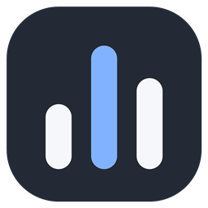
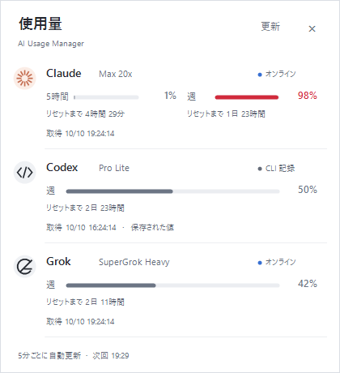
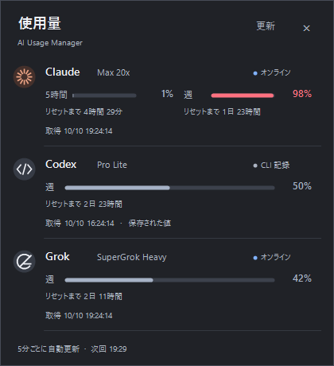
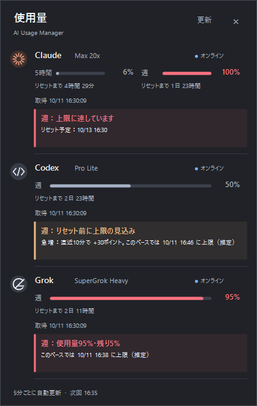
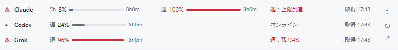
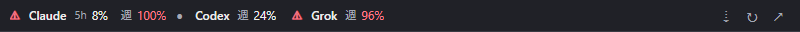
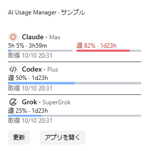
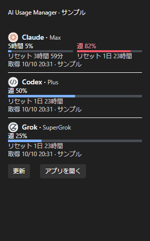

# AI Usage Manager

Claude・Codex・Grok の使用量をまとめて確認する、Windows 11用の軽量タスクトレイアプリです。

トレイ版はWindows標準の **.NET Framework 4.8 / 4.8.1 と Windows Forms** で動作します。追加ランタイム、WebView2、Node.js、Python、NuGetは不要です。表示言語は日本語です。Windowsウィジェット版は追加の登録・ランタイムが必要なオプションです。

| ライト | ダーク |
|---|---|
|  |  |

画像は架空のプラン・使用率によるサンプルです。

## ダウンロード・起動

1. [最新版のRelease](https://github.com/genkis3zu/AIUsageManager/releases/latest) から `AIUsageManager-1.0.0-windows.zip` をダウンロードします。
2. ZIPを、書き込み可能な任意のフォルダーに展開します。
3. **AIUsageManager.exe** を起動します。`AIUsageManager.exe.config` は同じフォルダーに置いてください。
4. タスクトレイの棒グラフのアイコンをクリックします。見当たらなければ `^` 内を確認してください。

対応するCLIの既存ログインや利用記録を参照します。利用できるログイン情報も保存された使用量もないサービスは「未取得」になります。管理者権限は不要です。インストーラーと自動起動登録はありません。

配布ファイルはコード署名されていません。ダウンロード元とReleaseのSHA-256を確認してください。保護機能の無効化は必要ありません。

## 表示するもの

| サービス | 使用枠 | データ元 |
|---|---|---|
| Claude | 5時間・週 | 既存Claude Codeログインによる使用量取得。失敗時は既存キャッシュ |
| Codex | 週 | 既存ChatGPTログインによるオンライン取得。通信失敗時はローカルのCodexセッション |
| Grok | 週 | 既存Grok CLIログインによる請求情報取得。認証・通信失敗時は未取得 |

- プラン名、使用率バー、リセットまでの時間、取得時刻を表示します。
- **80%以上は赤**。値がない「未取得」と、取得済みの **0%** を区別します。
- ログを今読み直しても取得時刻を現在時刻に置き換えません。15分以上前の観測には「保存された値」と表示します。
- リセット期限を過ぎても、再取得できるまでは0%に戻しません。
- GrokはUltra・Superなどの新プラン名に対応し、オンラインの契約名を優先します。プラン名に `*` が付く場合は、マウスを重ねると取得元や旧名が残る場合の説明を確認できます。
- Grokのログイン切れや取得失敗時は、古いCLI使用量へ戻さず、数値とバーを非表示にします。
- Grokのリセット後に使用率が省略された場合は、公式画面側の応答と現在の週を追加確認し、確認できた0%を表示します。
- GrokはGrok Build CLIの請求情報を参照します。Grok Botの別枠は取得しません。CLIの `grok usage` が返すセッション別のトークン数・費用とは異なる値です。

### 使用量の警告（1.1開発版）

90%・95%・100%に達したとき、Windows通知と画面内の警告帯で知らせます。急増や「このペースではリセット前に上限に達する見込み」も通知します。同じ警告を5分更新のたびに繰り返しません。

トレイ右クリック → **通知** で「上限・急増・到達予測」「90%・95%・100%のみ」「通知しない」を選べます。初期設定はすべて通知です。通知を切っても画面内の警告は残ります。ウィジェットにも上限に近い状態を文章で表示します。

到達予測は使用率の履歴を蓄積し、過去の予測と実績の誤差に応じて補正します。週枠は24時間分、5時間枠は30分・3回以上の観測が揃うまで「学習中」です。閾値・急増の警告は学習中も使えます。詳しくは [使用量の警告](docs/alerts.md) を参照してください。**v1.0.0のReleaseには未収録**です。

トレイとObsidianでは現在の割合、推定ペース、90%・95%への目安幅、100%の中心目安、履歴量と検証誤差を確認できます。直近平均・長期平均・曜日時間帯を比較し、誤差の小さい方法へ重みを寄せます。トレイ右クリック → **予測の学習** で状態の確認と履歴削除ができます。将来の作業量によって外れるため、精度の保証ではありません。



### ログイン

Codex・Grokのログインが必要な場合、該当行とウィジェットに「ログイン」ボタンが出ます。トレイの右クリック →「ログイン」からも操作できます。

ボタンを押すと、インストール済みの公式CLIが認証画面を開きます（Codex: `codex login`、Grok: `grok login --oauth`）。CLIのウィンドウとブラウザでログインを完了すると、トレイの使用量を自動で再取得します。ウィジェットは「更新」または次回の自動更新で反映します。CLIが未導入の場合は、その旨を表示します。

AI Usage Managerが認証ファイルを書き換えることはありません。ボタンから起動した公式CLIは、通常のログインと同じように認証情報を保存・更新します。APIキーの入力やコピーは不要です。

## 操作

| 操作 | 動作 |
|---|---|
| トレイを左クリック | 一覧を開く／閉じる |
| 「更新」または F5 | 手動で再取得 |
| 自動更新 | 前回の取得完了から5分後 |
| 外側をクリック、Esc、×、Alt+F4 | ポップアップを閉じて常駐を継続 |
| トレイ右クリック → テーマ | Windowsに合わせる／ライト／ダーク |
| トレイ右クリック → 通知 | すべて／上限のみ／通知しない |
| トレイ右クリック → 終了 | 常駐を終了 |
| 起動済みのexeを再実行 | 既存のポップアップを表示 |

初期テーマは「Windowsに合わせる」。Windowsのテーマ変更にも追従します。コントラストテーマが有効ならその配色を優先します。テーマと通知の選択を、exeの横の `settings.ini` に保存します。

## プライバシー

サービスのログ・認証・設定ファイルは**読み取り専用**です。トークンや生のAPIレスポンスをログ・画面・アプリの設定ファイルへ出力しません。予測用の割合・取得／リセット時刻・既知のプラン名を、このPCのユーザー別領域に暗号化して最大90日保存します。会話内容やアカウントIDは保存せず、履歴は削除できます。通知とウィジェットの表示内容はWindowsが保持する場合があります。テレメトリー、自動更新通信、独自サーバーへの送信はありません。


各サービスの取得時は、そのサービスの固定HTTPSエンドポイントに認証情報を送ります。読み取り対象・通信先・保存する内容は [プライバシー文書](docs/privacy.md) に記載しています。

## 制限・トラブルシューティング

- 各サービスの取得先は非公開仕様のため、将来変更される可能性があります。サービス各社の公式アプリではありません。
- 認証切れの場合、Codex・Grokは「ログイン」ボタン、ClaudeはClaude Codeの通常の再ログインを使用してください。バックグラウンドでのトークン更新はしません。
- 「CLI 記録」は最後にログへ保存された時点の値です。オンライン取得に失敗して保存値へ戻った場合、元の取得時刻と失敗理由を表示します。
- カスタムCLIホーム、複数アカウント切り替えは未対応です。
- 詳細な読取形式・上限は [データ取得仕様](docs/data-sources.md) を参照してください。

## ビルド・開発

### Obsidianの固定ツールバー（1.1開発版）

デイリーノートなどの上部に、本文をスクロールしても残る使用量ツールバーを表示できます。**標準は3行、縮小は1行**。⇡／⇣で切り替え、選択を保存します。編集・リーディングの両モードに対応し、ノート本文やテンプレートは変更しません。





使用量・警告は常駐アプリと共通です。Windows版Obsidian用のオプションプラグインで、認証情報にはアクセスせず、サービスへの追加問い合わせも行いません。導入と操作は [Obsidian連携ガイド](docs/obsidian-guide.md) を参照してください。**v1.0.0のReleaseには未収録**です。

### Windowsウィジェット（1.1開発版）

Win+Wのボードに、中／大サイズの使用量カードを追加できます。3サービスの使用率・プラン・リセット時間・取得時刻、手動更新、トレイを開く操作に対応します。表示が有効な間は5分ごとに更新し、配色はボードのライト／ダークに追従します。

Windows App Runtime 2.5.1 x64以降、Windows Web Experience Pack、開発者モードが必要です。通常のトレイ版ZIPには含まれません。**v1.0.0のReleaseには未収録**です。ビルド・登録・削除は [追加手順](docs/widgets-guide.md)、内部構成は [設計](docs/windows-widgets.md) を参照してください。

| 中サイズ（ライト） | 大サイズ（ダーク） |
|---|---|
|  |  |

画像は架空値をAdaptive Cardsの公式ホスト設定で描画したプレビューです。Windowsのボードでの見え方には差が出る場合があります。

### トレイ版

Windows PowerShell 5.1 とWindows同梱C#コンパイラだけでビルドできます。実行中のアプリは先に終了してください。

```powershell
git clone https://github.com/genkis3zu/AIUsageManager.git
cd AIUsageManager
powershell.exe -NoProfile -ExecutionPolicy Bypass -File .\build.ps1
```

テストの成功後、ルートにexeとconfigを生成します。`ExecutionPolicy Bypass` はこのプロセスだけに適用されます。詳しくは [開発・貢献ガイド](CONTRIBUTING.md)、[設計](docs/design.md)、[検証範囲](docs/verification.md) を参照してください。

## ライセンス・参考

[MIT License](LICENSE)。アプリアイコンもこのリポジトリのMITライセンスで利用できます。各サービスの名称・商標はそれぞれの権利者に帰属します。

取得プロトコルと項目名の確認に [CodeZeno/Claude-Code-Usage-Monitor](https://github.com/CodeZeno/Claude-Code-Usage-Monitor)（MIT）を参考にしました。本体コードとアイコンは新規実装です。

- [Claude Code status line](https://code.claude.com/docs/en/statusline)
- [Windows標準搭載 .NET Framework](https://learn.microsoft.com/en-us/dotnet/framework/install/on-windows-and-server)
