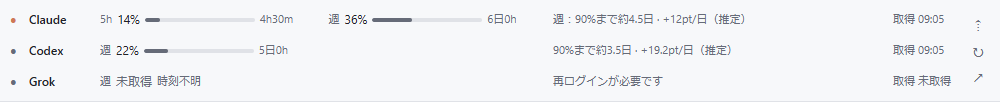

# Obsidianの固定ツールバー（1.1開発版）

ノート上部にAI使用量を表示します。本文をスクロールしても上に残り、編集・リーディングの両モードで利用できます。デイリーノートを含むMarkdownの各ペインに表示し、ノートやテンプレートには書き込みません。

## 表示と操作

- **標準表示**：Claude・Codex・Grokを1行ずつ、計3行。使用率、バー、状態、取得時刻を表示します。
- **縮小表示**：3サービスを横にまとめた1行。Claudeの5時間・週、Codex・Grokの週を表示します。
- **⇡／⇣**：標準と縮小を切り替えます。選択は保存され、すべてのノートペインに適用されます。
- **↻**：常駐アプリに使用量の更新を依頼します。終了していれば起動します。
- **↗ またはサービス名**：トレイアプリの詳細画面を開きます。ログイン操作も詳細画面から行えます。
- **マウスを重ねる**：プラン、リセット時間、取得元・日時、警告の全文を確認できます。

狭いペインでは補足を省略し、入りきらない場合は横スクロールできます。配色はObsidianのライト／ダークに追従します。縮小時も高使用量・急増・到達予測の警告マークを残します。

標準表示には90%までの予測幅と学習状態を表示します。マウスを重ねると、現在の割合、学習した1日／1時間あたりのペース、90%・95%・上限の目安、過去の検証誤差を確認できます。最近の平均・長めの平均・曜日や時間帯の傾向を組み合わせ、実績に応じて補正します。週枠は有効な24時間分、5時間枠は30分分と3件以上の観測がそろうまで学習中です。リセットが先に来る場合や時期を確定できない場合も区別します。Grokが未ログイン・取得失敗の場合は「未取得」とし、バーは出しません。履歴の保存・削除は常駐アプリ側で行い、Obsidianには履歴や認証情報を渡しません。

下の画像は従来の予測表示を使ったレイアウトの参考です。現在の予測文には幅と学習状態が含まれます。




「未取得」と取得済みの0%は区別します。15分以上前の値、取得失敗、リセット期限経過は現在の警告として扱いません。常駐アプリへの接続が切れた場合は「アプリ未接続」と表示します。

## 必要なもの

- Windows版Obsidian 1.5.0以降（実機確認：1.14.4）。モバイル・macOS・Linuxは対象外です。
- **このプラグインと同じソース版からビルドしたAI Usage Manager**。Obsidian連携を含まない旧ビルドやv1.0.0では動作しません。
- コミュニティプラグインを利用できるVault。

これは1.1開発版の機能で、v1.0.0のReleaseには含まれません。

## 導入

プラグインZIPを展開し、次のコマンドに実際のVaultとアプリの場所を指定します。現在ユーザーのファイルへ導入するため管理者権限は不要です。

```powershell
powershell.exe -NoProfile -ExecutionPolicy Bypass -File .\install-obsidian.ps1 -VaultPath "C:\Notes\MyVault" -AppPath "C:\Apps\AIUsageManager\AIUsageManager.exe"
```

Obsidianを再起動し、「設定 → コミュニティプラグイン」で **AI Usage Manager** を有効にします。既存版の更新ではプラグインの再読み込みでも反映できます。

手動導入の場合は `ai-usage-manager` フォルダーをVaultの `.obsidian/plugins/` へコピーします。有効化後、プラグイン設定でローカルドライブの `AIUsageManager.exe` のフルパスを指定してください。共有フォルダーや相対パスは指定できません。普段起動するアプリと同じパスを選びます。

設定をVaultと一緒に同期している場合、アプリのパスも同期されることがあります。別のPCではそのPCのパスを設定してください。

## 更新・解除

プラグインは15秒ごとに常駐アプリの表示データを読みます。サービスへの問い合わせは常駐アプリの5分更新と手動更新だけで、プラグインは追加のAPI取得を行いません。

「連携できません」と出た場合は実行ファイルのパスとビルドを確認してください。「アプリ未接続」は↻で起動できます。古い取得時刻が続く場合は↗から取得状態やログインを確認します。

無効化するとツールバーと定期読み取りが停止します。不要になった場合はObsidianのプラグイン管理画面からアンインストールできます。ノートの編集や元に戻す処理は不要です。

## ソースから作る

Node.js 18以降はプラグインのテスト・ビルドにだけ使用します。npm installや追加モジュールは不要です。実行にはObsidian内蔵の環境を使います。

```powershell
node --test obsidian/tests/usage.test.cjs obsidian/tests/bridge.test.cjs
node tools/build-obsidian.cjs
powershell.exe -NoProfile -ExecutionPolicy Bypass -File tools/package-obsidian.ps1 -SkipBuild
```

生成先は `build/obsidian/ai-usage-manager`、ZIPは `dist` です。配布する実行ファイルは `main.js`・`styles.css`・`manifest.json` の3つだけです。詳しい情報管理は同梱のPRIVACY.md、ソース側は [プライバシー文書](privacy.md) と [設計](obsidian-toolbar.md) を参照してください。
